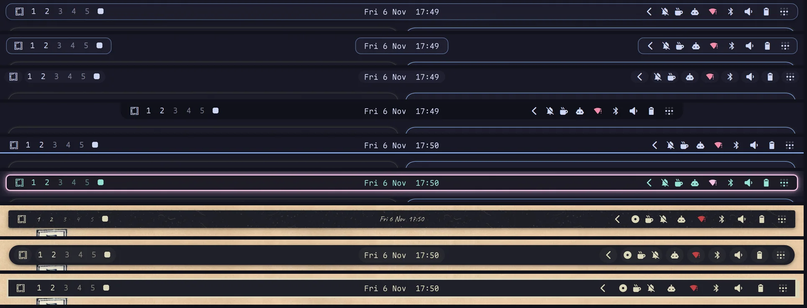
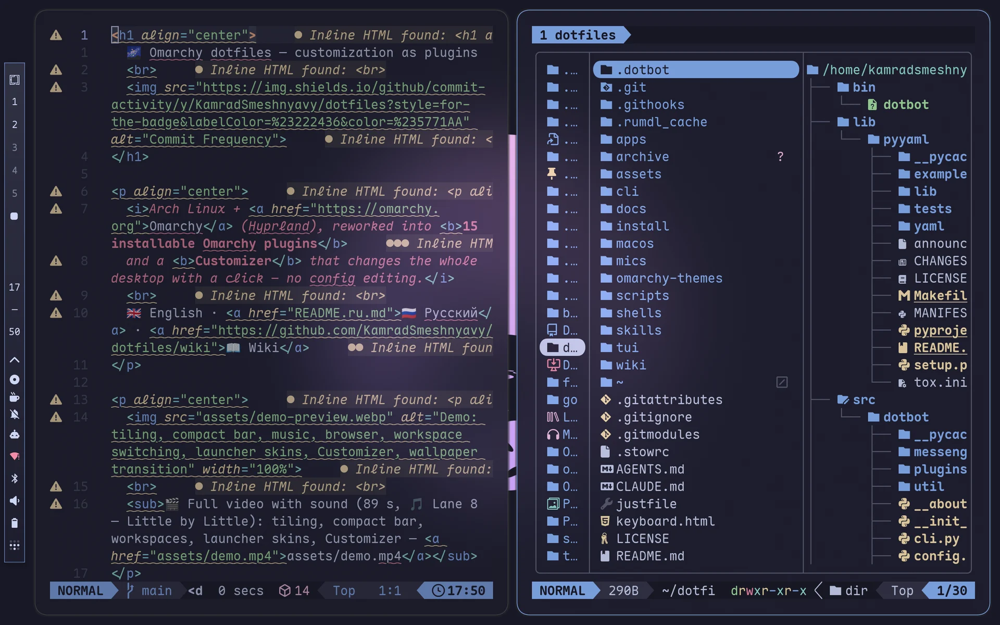
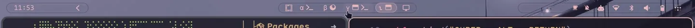
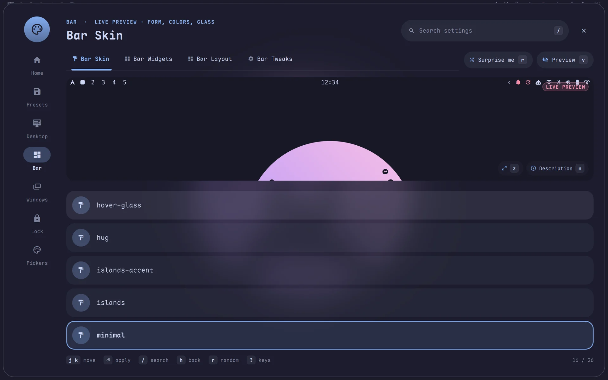

# Omarchy Bar Skins

[🇷🇺 Русский](README.ru.md)

A drop-in replacement for the [Omarchy](https://omarchy.org) top bar: the stock `omarchy.bar` with a skin
layer on top. Every widget, panel and gesture of the stock bar keeps working — the skin only changes how
the bar is drawn.

- **28 skins** (`liquid` draws its own glass: a highlight along the bar, a bright lit edge, a double light rim and an accent glow on the far side; the `liquid: true` key works in any skin) — floating, islands, pill, notch, underline, hug, frame, dotmatrix, paper, soft, brutal, bevel, glass, liquid, notches, glyph-pill, surface-dock, neon, capsules, autohide, …
- **10 layouts** — centered, bottom, left-vertical, dotmatrix, right-heavy, media-center, …
- **Compact mode** — the bar shrinks to a thin strip (only when a window is focused, only in fullscreen, or
  always) and expands back when you hover it
- **Workspaces** — 20+ label styles (roman, kanji, greek, circled, braille, leds…), app icons per workspace,
  an accent pill under the active one
- Colours are theme roles, so the bar recolours itself with every `omarchy theme set`





<!-- Demo video: repo-videos/omarchy-bar-skins.mp4 — drag it here when editing this file on GitHub -->

Compact mode expanding on hover:



## Install

```sh
omarchy plugin add https://github.com/KamradSmeshnyavy/omarchy-bar-skins --enable
omarchy restart shell
```

`--enable` makes it the bar in use (`bar.id` in `~/.config/omarchy/shell.json`). If the plugin fails to
load, the shell falls back to the stock bar on its own. To go back manually:
`omarchy plugin enable omarchy.bar`.


## Requirements

Omarchy 4 (Quattro) with its shell. Tested on Omarchy 4.0.6 with Quickshell 0.3.2.

- Optional: `cava` for the audio visualizer module.
- DOT-MATRIX designs use the fonts shipped with the [Customizer](https://github.com/KamradSmeshnyavy/omarchy-customizer) (Doto, Space Grotesk, Space Mono); without them they fall back to the Omarchy font.

## Uninstall

```sh
omarchy plugin enable omarchy.bar      # switch back to the stock one first
omarchy plugin remove kamradsmeshnyavy.bar
omarchy restart shell
```

Your settings stay in `~/.config/omarchy/bar-skin.json`, `~/.config/omarchy/bar-skins/`, `~/.config/omarchy/bar-layouts/` — delete them by hand if you don't need them.

## Pick a skin

The active skin is `~/.config/omarchy/bar-skin.json`. The bar watches the file and redraws instantly:

```sh
cp ~/.config/omarchy/plugins/kamradsmeshnyavy.bar/skins/islands.json ~/.config/omarchy/bar-skin.json
```

A layout goes into the `bar` section of `shell.json`:

```sh
cd ~/.config/omarchy
jq --slurpfile l plugins/kamradsmeshnyavy.bar/layouts/centered.json '.bar += $l[0]' shell.json > shell.json.new \
  && mv shell.json.new shell.json
```

The [Customizer](https://github.com/KamradSmeshnyavy/omarchy-customizer) drives all of this in one
overlay with live preview — skins, layouts and every setting below:



## Skin schema

```jsonc
{
  "shape": "floating",        // full floating pill islands notch underline hug frame
  "height": 30,               // 0 = stock height
  "gap": 6,                   // distance from the screen edge
  "margin": 10,               // left/right margins
  "width": 1.0,               // share of the screen width (floating/pill/notch)
  "radius": 12,
  "frameWidth": 8,            // frame: border width along the other screen edges
  "padding": -1,              // module padding inside the background; -1 = stock
  "islandGap": 6,
  "background": "bar",        // colour: a role or #hex
  "backgroundAlpha": 0.85,    // -1 = alpha from the theme
  "gradient": "accent",       // second colour of a horizontal gradient (omit for none)
  "border": "accent", "borderWidth": 1, "borderAlpha": 0.6,
  "text": "bar", "active": "bar",
  "shadow": true,
  "glow": false,              // a halo in the border colour instead of a shadow
  "autoHide": false,          // hide behind the edge, slide out on hover
  "moduleStyle": "plain",     // plain pills hover
  "moduleBackground": "foreground", "moduleAlpha": 0.08,
  "spacing": 0,
  "font": "",                 // empty = system font
  "texture": "",              // PNG tile over the plate (~ expands); on a dark plate <name>-dark.png is used
  "textureAlpha": 0.9,
  "hardShadow": 0,            // hard offset shadow in px, border colour (brutalism; islands too); Customizer → Widgets → Shadows overrides it
  "bevel": false,             // retro 3D bevel: light top-left, dark bottom-right
  "transparent": false        // stock transparent mode (written to shell.json)
}
```

A colour is `bar` (the stock bar colour from the theme's `[bar]`), a shell role (`background`,
`foreground`, `accent`, `muted`, `urgent`), any key of the current theme's `colors.toml` (`red`, `cyan`,
`lighter_background`, …) or `#rrggbb`. Roles follow the theme.

Shapes: `full` is stock; `floating` — a strip with gaps; `pill` — floating with half-height radius;
`islands` — one island per section; `notches` — an island per section hanging from the screen edge, only the
corners facing the screen rounded (after Vitreus; skin + layout `notches`); `notch` — a notch at the edge; `underline` — a line along the edge;
`hug` — full width with concave corners below it; `frame` — a strip plus a border of the bar colour along the
other three screen edges, with rounded inner corners (`radius`, at least 8) and space reserved so windows sit
inside it. Vertical bars support only `full`, `floating` and `frame`.

### Compact

| Key | Default | |
|---|---|---|
| `compact` | `off` | `single` — one tiled window on the workspace; `fullscreen`; `always`; `empty` — no windows on the workspace |
| `compactHeight` | `22` | background height in compact; `0` — unchanged |
| `compactModules` | `essentials` | `essentials` (menu, workspaces, clock, network, audio, power), `center`, `minimal`, `all`, `taskbar` (only the Taskbar module) |
| `compactShape` | `full` | shape in compact; `same` — as usual |
| `compactAlpha` | `-1` | background alpha in compact |
| `compactReserve` | `keep` | `keep` — windows don't jump; `shrink` — windows take the space |
| `compactExpandOnHover` | `true` | expand on hover and while a bar panel is open |

### Workspaces

| Key | Default | |
|---|---|---|
| `wsLabelStyle` | `omarchy` | omarchy numbers circled circled-filled circled-sans circled-sans-filled parens fullwidth superscript roman roman-small kanji greek cyrillic braille dots leds squares diamonds stars triangles hearts hexagons bars none |
| `wsWindowIcons` | `false` | app icons inside a workspace |
| `wsIconStyle` | `color` | color mono tinted accent bubble faded glyph letter dots count |
| `wsMaxIcons` | `3` | icons per workspace, the rest is `+N` |
| `wsDedupe` | `true` | one icon per app |
| `wsShown` | `5` | workspaces always visible |
| `wsShowEmpty` | `true` | show empty ones |
| `wsActivePill` | `false` | accent pill under the active one |
| `wsActiveColor` | style | colour of the active workspace: a role or `#hex` |


**Vitreus bar** (after [Vitreus](https://github.com/natepayn3/Vitreus), own code): skins `vitreus-island` (one rounded glass plate at the top), `vitreus-frame` (the caelestia shape — a glass strip down one side and a thin frame round the screen with rounded inner corners, all one piece of glass under the windows) and `vitreus-notches` (three glass pieces hanging from the top edge, melting into it with concave curves), with layouts `vitreus-island`, `vitreus-frame-left`, `vitreus-notches`. The layouts use Vitreus modules (`modules/Vit*.qml`, own code): `vit-workspaces` — marks for busy workspaces, the current one a capsule in an accent gradient whose head flies ahead (128 ms) and tail catches up (340 ms), a warm dot for a workspace asking for attention, `+` for the first empty one; `vit-clock` — the hour large in the accent gradient (the title font of the font profile), a pencil stroke, the minutes, weekday and date, `"hour12": true` for am / pm, click — dashboard; `vit-title` — app name over the window title, turned along a side strip; `vit-icons` — a card with line icons for overview, search, Customizer and the Super+M panel (`"items"` picks which). **yami bar** (after [yami](https://github.com/Trendorin/yami), MIT, own code): skin `yami` (a thin dark bar across the whole top edge with a one-pixel accent line, the Tiny5 font) and layout `yami` with its modules — `YamiButton` (launcher grid, gear, power in a box; `"icon"`, `"command"`, `"boxed"`), `YamiWorkspaces` (numbered square cells of the busy workspaces, the current one in the accent), `YamiTask` (the focused window as an accent button, `"width"`), `YamiMeter` (`"kind"`: `cpu` / `ram` — six cells and a percent, `temp`), `YamiClock` (`00:21 Fr 13.11`). **Rumda bar** (after [Rumda](https://github.com/hexonide/rumda), no licence — look only, own code): skin `rumda` (a narrow pill on the left, 80 px off the top and bottom, a 3 px border, the Dogica Pixel font) and layout `rumda` — every module in its own rounded card (`RumdaCard`): `RumdaClock` (hours over minutes), `RumdaVolume` (a vertical bar), `RumdaRings` (cpu / ram rings), `RumdaWorkspaces` (slanted marks), `RumdaButton` (`"kind"`: `theme` — dark ↔ light rumda theme, `weather`, `net` — a cat face, `power`) `RumdaArt` (sand waves across a dark bar) and `RumdaCat` (first in the layout: an own vector cat sitting on the top end of the bar in the light accent — blinks, twitches an ear, swings the tip of its tail, and hops off the bar for a moment when the theme changes; `"lift"` — how far above the bar). **surface bar** (after [surface-dots](https://github.com/snes19xx/surface-dots) by snes19xx; its README allows reuse with credit): skin `surface` (a transparent 40 px bar across the top, the Manrope font) and layout `surface` — `SurfLauncher` (the blue Arch glyph tilting on hover; left click — launcher, right click — dark ↔ light surface theme), `SurfWorkspaces` (a pill of ten workspaces: window icons by class — its own icon table in `SurfIcons.js` — or a dot, an accent pill sliding under the current one, a translucent overshooting pill under the hovered one, urgent windows blinking), `SurfMedia` (♫ song - artist while something plays, otherwise the window title; click — play / pause), `SurfStatus` (`"kind"`: `updates` — green pill with the pacman icon and the `checkupdates` count, click — `omarchy-update`; `battery` — colour by level, blinking at 10 %, a ring when charging starts; `clock` — `Sun, Nov 15 • 3:47 PM`, click — dashboard; `"hour12": false` for 24 h). The pills (`SurfPill.qml`) are the card colour at 78 % with a diagonal glint sweeping across on hover; colours (`SurfPal.qml`) are the roles of its ThemeEngine computed from the current theme. Its taskbar mode: skin `surface-task` (a 50 px frame strip at the bottom with `"frameEmptyOnly": true` — the 7 px frame with rounded inner corners shows only on an empty workspace, fades out with windows and keeps no space; `"compact": "empty"` with `"compactModules": "surface"`) and layout `surface-task` — with windows: the Arch glyph, the workspace pill, the song, tray, updates, battery, date · time; on an empty workspace only `SurfDock` (the Arch glyph, pinned apps of the Omarchy dock — `omarchy dock pin`, the time) and the battery. The launcher buttons of this layout open the wide `surface-wide` launcher (Programs grid). **Cozytile bar** (after the qtile bar of [Cozytile](https://github.com/Darkkal44/Cozytile), no licence — look only, own code): skin `cozytile` (a floating 30 px pill 15 px from the top and 60 px from the sides in the lighter fill of the theme) and layout `cozytile` with `CozyModule.qml` (`"kind"`: `launcher` — four diamonds, click — power menu; `groups` — dots of workspaces 1–8, busy in the accent, the current one in its own colour; `layout` — the workspace layout, click — next layout; `search`; `title`; `memory`; `battery`; `volume`; `clock`). `"tab": "start" | "mid" | "end"` puts a module into a dark tab with S-shaped slanted sides, `"slash": true` adds a slanted separator; colours come from `colors.toml` of the current theme (`CozyPal.qml`). **Unit-3 bar** (after [Unit-3](https://github.com/samyns/Unit-3) by samyns, MIT — its waybar config and style.css): skin `unit3` + layout `unit3`, `modules/Unit3Module.qml` — a thin 28 px bar across the top in Share Tech Mono with a 1 px line under it; workspace numbers with a 2 px underline on the current one, «// window title», a pale Japanese ticker in the middle, and on the right, split by thin lines, «POMO 25:00» (click — start / pause, right click — reset), CPU (red), MEM (blue), NET (green, click — Wi-Fi), VOL (gold, click — sound, wheel — volume, right click — mute), the clock (click — the date) and ⏻ (the power menu). **Space bar** (after the Space style of [elifouts/Dotfiles](https://github.com/elifouts/Dotfiles), GPL-3.0 — its bar/Pill.qml, Module.qml, Workspaces.qml, DecodeText.qml): skin `space` (two floating 28 px boxes, the background fading from 72 % to 42 % top to bottom, a 1 px accent line at 40 % and 7 px accent corner brackets — skin keys `"brackets"`, `"gradientVertical"`, `"gradientAlpha"`) and layout `space` with `modules/SpaceModule.qml` (`"kind"`: `user` — dashboard; `stars` — the workspaces as stars: the current one a glowing accent star, a workspace with windows a bigger dot with extra windows orbiting as moons, a comet across the bar on switch; `media` — the player, the song while playing; `net`; `audio` — a 12-cell scale, wheel — volume; `battery`; `notifs` — history; `clock` — `hh:mm AP`, click — 24 h; `power`). Labels are uppercase spaced-out JetBrains Mono and «decode» through noise when they appear (`SpaceDecode.qml`). **Bruteon bar** (after the neo-brutalism rice of [Bruteon](https://github.com/Darkkal44/Bruteon), look from its screenshots, own code): skin `bruteon` (three cream islands 44 px high with a 3 px dark outline and a hard shadow) and layout `bruteon` with `BruteModule.qml` (`"kind"`: `power`; `workspaces` — workspaces 1–6 with their own icons like its bar (terminal, browser, chat, files, music, settings; `"icons"`, `"count"`), a bar under busy ones, the current one on a peach tile, empty ones faded; `apps` — pinned apps of the Omarchy dock as line glyphs (web apps — their own icon tinted with the ink); `tasks` — green «Tasks», opens the tasks and pomodoro panel over the windows; `media` — the dashboard tile (✕ while it is open) and the song; `status` — sound, Bluetooth, Wi-Fi (their sections of the Super+M panel); `clock` — the lavender pill with a PM box; `bell` — history, right click — do not disturb). Tiles — `BruteTile.qml`: outline and a hard shadow that grows on hover. The skin key `"vitreus": true` draws the bar with real liquid glass (`LiquidGlass.qml`, `shaders/liquidglass.frag`: the wallpaper refracted at the edge, rainbow fringe, rim, dome and a pointer highlight; settings in `~/.config/omarchy/glass.json`). The skin key `"tabs": true` (on in both `vitreus-frame` skins, plastic too) adds tabs in the middle of the top and bottom frame edges (`VitTabs.qml`): hover and a 81 × 23 tab with three dots grows out of the frame, joined to it by concave curves — the top one opens the app launcher, the bottom one Prefs (Super+Alt+I). The bar also writes its geometry to `$XDG_RUNTIME_DIR/omarchy-bar-geom.json` (edge, size, frame, the module buttons per screen), so panels in other plugins can grow out of their own button. **Module panels merge with the bar.** With a bar that runs the whole edge (frame, full) the cards of module panels (audio, network, Bluetooth, monitor, the DOT-MATRIX clones — everything drawn by `KeyboardPanel` from `qs.Ui`) merge into it: the bar implements `notePopoutCard`, and `PopBridge.qml` draws an Overlay bridge over the card — fills the gap in the card colour, squares its corners on the bar side, continues its outline to the bar edge and adds concave corners (`MergeFillet.qml`). Skin key `"mergePopups": false` turns it off; floating pills and islands keep the gap. Popup menus (`PopupCard` from `qs.Ui`: the tray icon menus, calendar, weather — xdg-popups of the bar) merge the same way: the bar finds the open one and tells the bridge where its card is. The bridge repaints the whole card outline in the bar's border colour, so the joint is one colour. **Modules on the desktop.** Drag any bar module more than 60 px off the bar and it leaves the layout for the desktop (`~/.config/omarchy/bar-desk.json`): a card in the bar colour with the bar outline (`omarchy-bar-desk`, under windows) holding the same module — clicks work as on the bar, drag it anywhere, at a frame / full-edge bar edge it sits flush and merges (the frame breaks its outline there); drop it next to the bar and it goes back into the layout, into the third of the bar it was dropped against. Past the bar edge Hyprland stops sending the bar pointer events, so the desk window carries the module from there on (it lands where the button is released or where the cursor rests for 0.7 s). **Moving module panels.** Every module panel card gets a red tab on its top edge; drag it and the card leaves the bar and moves freely over the desktop (the panel stays open). Let go within 32 px of a frame / full-edge bar edge and it sits there flush and merges with that edge through the same bridge. The spot is remembered per module (`~/.config/omarchy/pop-places.json`), so the panel opens right there next time; double-click the tab to send it back to the bar and forget the spot. Popup menus get the tab too, inside the card's top edge; Hyprland does not move a shown xdg-popup, so while it is dragged an outline follows the cursor and the menu reopens where it is dropped.

**New layouts.** `glyph-rice` (the bar of [glyph-rice](https://github.com/Nebelung-cloud/glyph-rice), ported as modules `modules/Glyph*.qml`: a dot-ring mark — the launcher, its centre turns red while recording or while the microphone is in use; workspace dots with the current one stretched into a pill; the window title rotated along the pill; a Doto clock in the middle — click: dashboard; Wi-Fi arcs, Bluetooth, sound — wheel: volume — and an upright battery that breathes while charging; click — Quick, right click — power menu. Tray parts and their order: `"parts": "wifi,bluetooth,sound,battery"` on the `glyph-tray` entry, title length: `"length"` on `glyph-title`), `notches` (three notches: launcher + workspaces, clock, status), `glyph-left` (a left pill after
glyph-rice: launcher and workspaces on top, RunCat in the middle, status, focus timer and clock below — with the
`glyph-pill` skin), `taskbar` (bottom: workspaces, the `Taskbar` module in the middle, status — with the `surface-dock`
skin). **Taskbar → dock** (after surface-dots): the `Taskbar` module shows the windows of the workspace (click — focus) and,
on an empty workspace, the pinned apps of the Omarchy dock (`omarchy dock pin <id>`; click — launch); the `surface-dock`
skin has `"compact": "empty"` + `"compactModules": "taskbar"`, so on an empty workspace the bar shrinks into a centred
pill with that module only.

## Files

| File | |
|---|---|
| `BarSkin.qml` | reads the skin, defaults, colour roles |
| `SkinFrame.qml` | the shaped background, input mask, exclusive zone |
| `SkinIsland.qml` | islands under sections |
| `SkinWorkspaces.qml` | workspaces widget that replaces `omarchy.workspaces` in this bar |
| `modules/` | custom QML modules for the `dotmatrix` layout (`DotMatrixMark`, `ActiveAppIcon`, `BatteryGauge`, `DotClock`, `PrivacyLed`) and for any layout: `RunCat` (a pixel cat that runs faster as CPU load rises), `CpuRamRings` (radial CPU / RAM), `CavaDots` (8×5 dot spectrum, only while music plays), `FocusTimer` (pomodoro: click — start / pause, right click — reset, wheel — ±5 min; state survives a shell restart) — put them on the bar from Customizer → Bar Widgets → Not on the bar; the tray, Wi-Fi, Bluetooth and sound in the layout are DOT-MATRIX clones of the Omarchy widgets, `kamradsmeshnyavy.{tray,network,bluetooth,audio}` |
| `skins/`, `layouts/` | presets |
| `UPSTREAM.md` | stock `omarchy.bar` docs: widget catalogue, custom modules |

Changes against the stock `Bar.qml` are marked `// skin:`, so the clone is easy to rebase onto a new
Omarchy release: `diff -u $OMARCHY_PATH/shell/plugins/bar/Bar.qml Bar.qml`.

## Related

- [omarchy-launcher-skins](https://github.com/KamradSmeshnyavy/omarchy-launcher-skins) — 10 full-screen launcher skins
- [omarchy-lock-designs](https://github.com/KamradSmeshnyavy/omarchy-lock-designs) — 21 lock screen designs
- [omarchy-wallpaper-fx](https://github.com/KamradSmeshnyavy/omarchy-wallpaper-fx) — 24 wallpaper transitions
- [omarchy-image-picker-styles](https://github.com/KamradSmeshnyavy/omarchy-image-picker-styles) — six theme/wallpaper picker styles
- [omarchy-customizer](https://github.com/KamradSmeshnyavy/omarchy-customizer) — one overlay for all of them, with live preview
- [dotfiles](https://github.com/KamradSmeshnyavy/dotfiles) — where all of them live

## With the Customizer

[omarchy-customizer](https://github.com/KamradSmeshnyavy/omarchy-customizer) is one overlay (Super+Shift+T) with live preview for this plugin's settings and
the rest of the look & feel: themes, wallpapers, Hyprland animations, transparency, blur, screen shaders.
Install it next to this plugin (it finds the other companions on its own):

```sh
omarchy plugin add https://github.com/KamradSmeshnyavy/omarchy-customizer --enable
```

## License

GPL-3.0 (see [LICENSE](LICENSE); earlier versions were MIT), credits — in [NOTICE](NOTICE). Based on `omarchy.bar` from
[Omarchy](https://github.com/basecamp/omarchy) (MIT, © David Heinemeier Hansson); the `Glyph*` modules come from
[glyph-rice](https://github.com/Nebelung-cloud/glyph-rice) (GPL-3.0).
