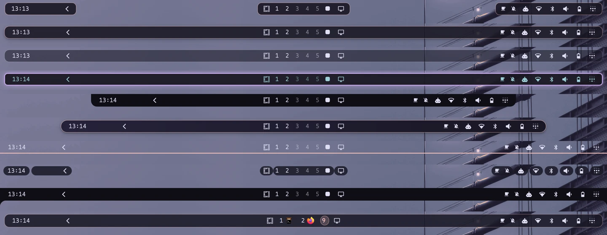
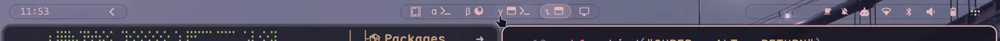
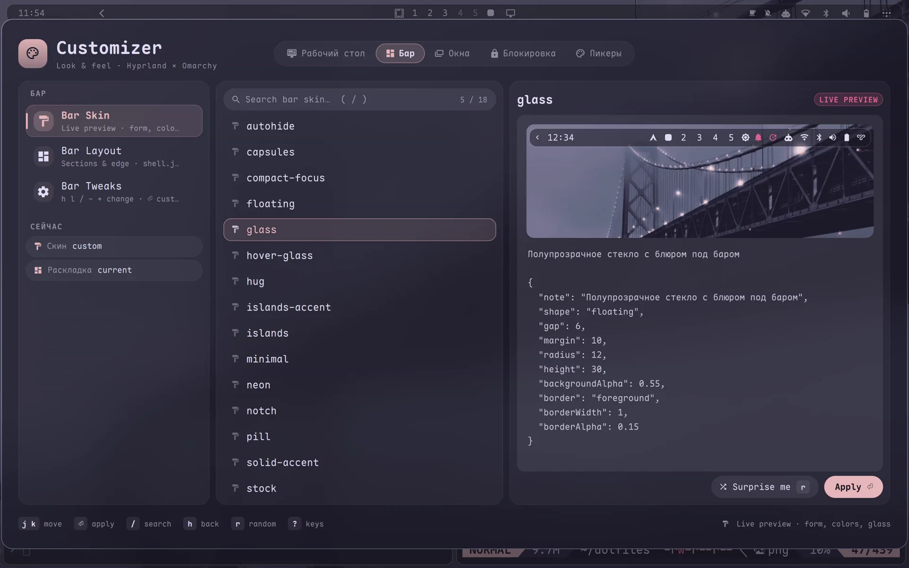

# Omarchy Bar Skins

[🇬🇧 English](README.md)

Замена верхнего бара [Omarchy](https://omarchy.org): стоковый `omarchy.bar` с прослойкой скинов. Все
виджеты, панели и жесты стокового бара работают как раньше — скин меняет только то, как бар нарисован.

- **18 скинов** — floating, islands, pill, notch, underline, hug, glass, neon, capsules, autohide, …
- **9 раскладок** — centered, bottom, left-vertical, right-heavy, media-center, …
- **Compact** — бар сжимается в тонкую полосу (при одном окне, в полноэкранном режиме или всегда) и
  разворачивается по наведению
- **Workspaces** — 20+ стилей подписей (римские, кандзи, греческие, в кружках, брайль…), иконки приложений,
  плашка под активным
- Цвета — роли темы: бар перекрашивается при каждом `omarchy theme set`





## Установка

```sh
omarchy plugin add https://github.com/KamradSmeshnyavy/omarchy-bar-skins --enable
omarchy restart shell
```

`--enable` делает его текущим баром (`bar.id` в `~/.config/omarchy/shell.json`). Если плагин не
загрузится, шелл сам вернёт стоковый бар. Вернуть вручную: `omarchy plugin enable omarchy.bar`.

Проверено на Omarchy 4.0.6 и Quickshell 0.3.2.

## Выбрать скин

Активный скин — `~/.config/omarchy/bar-skin.json`; бар следит за файлом и меняется на лету:

```sh
cp ~/.config/omarchy/plugins/kamradsmeshnyavy.bar/skins/islands.json ~/.config/omarchy/bar-skin.json
```

Раскладка дописывается в секцию `bar` файла `shell.json`:

```sh
cd ~/.config/omarchy
jq --slurpfile l plugins/kamradsmeshnyavy.bar/layouts/centered.json '.bar += $l[0]' shell.json > shell.json.new \
  && mv shell.json.new shell.json
```

В [моих dotfiles](https://github.com/KamradSmeshnyavy/dotfiles) всё это делается в оверлее **Customizer**
с живым предпросмотром (Super+Shift+T: Bar Skin, Bar Layout, Bar Tweaks):



## Схема скина

```jsonc
{
  "shape": "floating",        // full floating pill islands notch underline hug
  "height": 30,               // 0 = стоковая высота
  "gap": 6,                   // отступ от края экрана
  "margin": 10,               // поля слева/справа
  "width": 1.0,               // доля ширины (floating/pill/notch)
  "radius": 12,
  "padding": -1,              // отступ модулей от краёв подложки; -1 = сток
  "islandGap": 6,             // поля островов
  "background": "bar",        // цвет: роль или #hex
  "backgroundAlpha": 0.85,    // -1 = альфа из темы
  "gradient": "accent",       // второй цвет горизонтального градиента (нет ключа — без градиента)
  "border": "accent", "borderWidth": 1, "borderAlpha": 0.6,
  "text": "bar", "active": "bar",
  "shadow": true,
  "glow": false,              // ореол цвета рамки вместо тени
  "autoHide": false,          // прятать за край, выезжает по наведению
  "moduleStyle": "plain",     // plain pills hover — подложка у каждого модуля
  "moduleBackground": "foreground", "moduleAlpha": 0.08,
  "spacing": 0,               // зазор между модулями
  "font": "",                 // пусто = системный шрифт
  "transparent": false        // стоковый прозрачный режим (пишется в shell.json)
}
```

Цвет — `bar` (стоковый цвет бара из `[bar]` темы), роль шелла (`background`, `foreground`, `accent`,
`muted`, `urgent`), любой ключ `colors.toml` текущей темы (`red`, `cyan`, `lighter_background`, …)
или `#rrggbb`. Роли перекрашиваются вместе с темой.

Формы: `full` — сток; `floating` — полоса с отступами; `pill` — floating с радиусом в полвысоты;
`islands` — остров под каждой секцией; `notch` — «чёлка» у края; `underline` — линия по краю; `hug` —
полоса во всю ширину с вогнутыми углами. Вертикальный бар умеет только `full` и `floating`.

### Compact

| Ключ | Умолч. | |
|---|---|---|
| `compact` | `off` | `single` — на workspace одно тайловое окно; `fullscreen`; `always` |
| `compactHeight` | `22` | высота подложки в compact; `0` — не менять |
| `compactModules` | `essentials` | `essentials` (меню, workspaces, часы, сеть, звук, питание), `center`, `minimal`, `all` |
| `compactShape` | `full` | форма в compact; `same` — как обычно |
| `compactAlpha` | `-1` | альфа фона в compact |
| `compactReserve` | `keep` | `keep` — окна не дёргаются; `shrink` — окна получают место |
| `compactExpandOnHover` | `true` | разворачивать по наведению и пока открыта панель бара |

### Workspaces

| Ключ | Умолч. | |
|---|---|---|
| `wsLabelStyle` | `omarchy` | omarchy numbers circled circled-filled circled-sans circled-sans-filled parens fullwidth superscript roman roman-small kanji greek cyrillic braille dots squares diamonds stars triangles hearts hexagons bars none |
| `wsWindowIcons` | `false` | иконки окон внутри workspace |
| `wsIconStyle` | `color` | color mono tinted accent bubble faded glyph letter dots count |
| `wsMaxIcons` | `3` | иконок на workspace, остальные — «+N» |
| `wsDedupe` | `true` | одно приложение — одна иконка |
| `wsShown` | `5` | сколько workspace видно всегда |
| `wsShowEmpty` | `true` | показывать пустые |
| `wsActivePill` | `false` | плашка цвета акцента под активным |
| `wsActiveColor` | как в стиле | цвет текущего workspace: роль темы или `#hex` |

## Файлы

| Файл | |
|---|---|
| `BarSkin.qml` | чтение скина, дефолты, цвета-роли |
| `SkinFrame.qml` | подложка по форме, маска ввода, exclusive zone |
| `SkinIsland.qml` | острова под секциями |
| `SkinWorkspaces.qml` | workspaces, подменяет `omarchy.workspaces` в этом баре |
| `skins/`, `layouts/` | пресеты |
| `UPSTREAM.md` | документация стокового `omarchy.bar`: каталог виджетов, свои модули |

Правки стокового `Bar.qml` помечены `// skin:` — после обновления Omarchy их легко перенести:
`diff -u $OMARCHY_PATH/shell/plugins/bar/Bar.qml Bar.qml`.

## Лицензия

MIT. Основано на `omarchy.bar` из [Omarchy](https://github.com/basecamp/omarchy) (MIT, © David Heinemeier Hansson).
