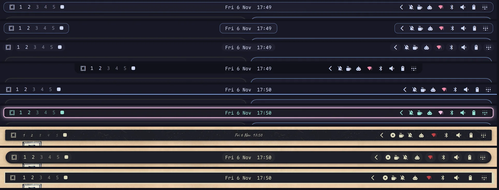
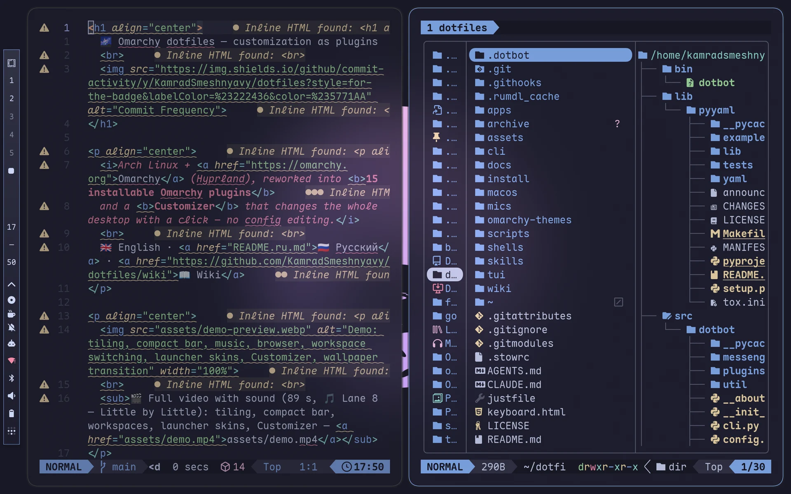
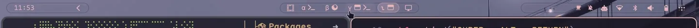
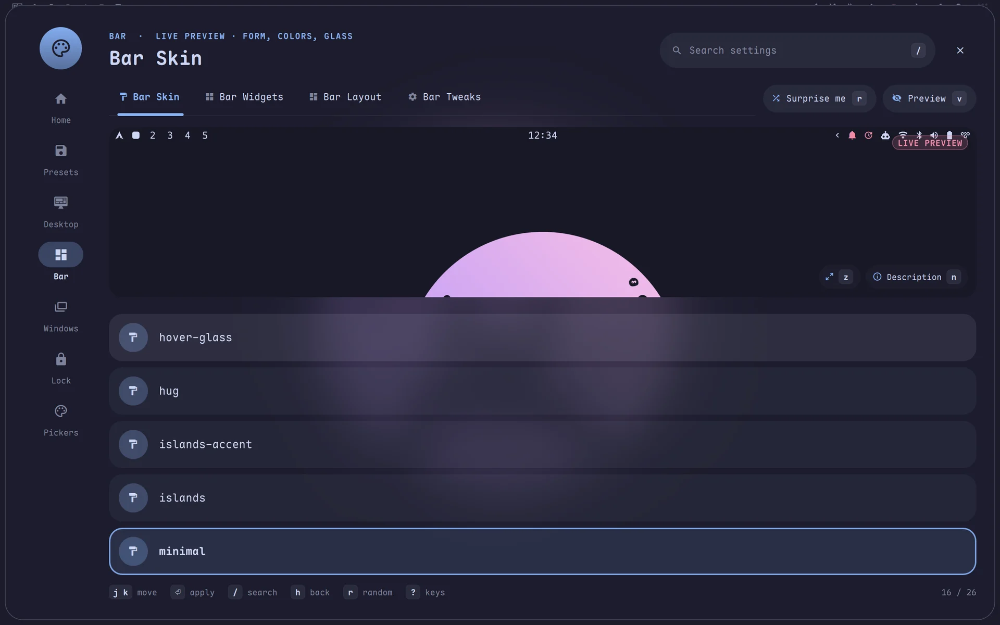

# Omarchy Bar Skins

[🇬🇧 English](README.md)

Замена верхнего бара [Omarchy](https://omarchy.org): стоковый `omarchy.bar` с прослойкой скинов. Все
виджеты, панели и жесты стокового бара работают как раньше — скин меняет только то, как бар нарисован.

- **28 скинов** (`liquid` рисует своё стекло: блик вдоль бара, яркую освещённую кромку, двойной светлый ободок и подсветку акцентом с другой стороны; ключ `liquid: true` работает в любом скине) — floating, islands, pill, notch, underline, hug, frame, dotmatrix, paper, soft, brutal, bevel, glass, liquid, notches, glyph-pill, surface-dock, neon, capsules, autohide, …
- **10 раскладок** — centered, bottom, left-vertical, dotmatrix, right-heavy, media-center, …
- **Compact** — бар сжимается в тонкую полосу (при одном окне, в полноэкранном режиме или всегда) и
  разворачивается по наведению
- **Workspaces** — 20+ стилей подписей (римские, кандзи, греческие, в кружках, брайль, leds…), иконки приложений,
  плашка под активным
- Цвета — роли темы: бар перекрашивается при каждом `omarchy theme set`





<!-- Demo video: repo-videos/omarchy-bar-skins.mp4 — drag it here when editing this file on GitHub -->



## Установка

```sh
omarchy plugin add https://github.com/KamradSmeshnyavy/omarchy-bar-skins --enable
omarchy restart shell
```

`--enable` делает его текущим баром (`bar.id` в `~/.config/omarchy/shell.json`). Если плагин не
загрузится, шелл сам вернёт стоковый бар. Вернуть вручную: `omarchy plugin enable omarchy.bar`.


## Требования

Omarchy 4 (Quattro) с его оболочкой. Проверено на Omarchy 4.0.6 и Quickshell 0.3.2.

- Необязательно: `cava` — модуль визуализатора звука.
- Дизайны DOT-MATRIX используют шрифты из [Customizer](https://github.com/KamradSmeshnyavy/omarchy-customizer) (Doto, Space Grotesk, Space Mono); без них — шрифт Omarchy.

## Удаление

```sh
omarchy plugin enable omarchy.bar      # сначала вернуть стоковый
omarchy plugin remove kamradsmeshnyavy.bar
omarchy restart shell
```

Настройки остаются в `~/.config/omarchy/bar-skin.json`, `~/.config/omarchy/bar-skins/`, `~/.config/omarchy/bar-layouts/` — удалите их вручную, если не нужны.

## Выбрать скин

Активный скин — `~/.config/omarchy/bar-skin.json`; бар следит за файлом и меняется на лету:

```sh
cp ~/.config/omarchy/plugins/kamradsmeshnyavy.bar/skins/islands.json ~/.config/omarchy/bar-skin.json
```

Раскладка дописывается в секцию `bar` файла `shell.json`:

```sh
cd ~/.config/omarchy
jq --slurpfile l plugins/kamradsmeshnyavy.bar/layouts/centered.json '.bar += $l[0]' shell.json > shell.json.new \
  && mv shell.json.new shell.json
```

В оверлее [Customizer](https://github.com/KamradSmeshnyavy/omarchy-customizer) всё это делается
с живым предпросмотром (Super+Shift+T: Bar Skin, Bar Layout, Bar Tweaks):



## Схема скина

```jsonc
{
  "shape": "floating",        // full floating pill islands notch underline hug frame
  "height": 30,               // 0 = стоковая высота
  "gap": 6,                   // отступ от края экрана
  "margin": 10,               // поля слева/справа
  "width": 1.0,               // доля ширины (floating/pill/notch)
  "radius": 12,
  "frameWidth": 8,            // frame: толщина рамки по остальным краям экрана
  "padding": -1,              // отступ модулей от краёв подложки; -1 = сток
  "islandGap": 6,             // поля островов
  "background": "bar",        // цвет: роль или #hex
  "backgroundAlpha": 0.85,    // -1 = альфа из темы
  "gradient": "accent",       // второй цвет горизонтального градиента (нет ключа — без градиента)
  "border": "accent", "borderWidth": 1, "borderAlpha": 0.6,
  "text": "bar", "active": "bar",
  "shadow": true,
  "glow": false,              // ореол цвета рамки вместо тени
  "autoHide": false,          // прятать за край, выезжает по наведению
  "moduleStyle": "plain",     // plain pills hover — подложка у каждого модуля
  "moduleBackground": "foreground", "moduleAlpha": 0.08,
  "spacing": 0,               // зазор между модулями
  "font": "",                 // пусто = системный шрифт
  "texture": "",              // PNG-тайл поверх подложки (~ раскрывается); на тёмной — <имя>-dark.png
  "textureAlpha": 0.9,
  "hardShadow": 0,            // жёсткая смещённая тень в px цветом рамки (брутализм; и у островов); Customizer → Виджеты → Тени сильнее
  "bevel": false,             // ретро-кант: светлый сверху-слева, тёмный снизу-справа
  "transparent": false        // стоковый прозрачный режим (пишется в shell.json)
}
```

Цвет — `bar` (стоковый цвет бара из `[bar]` темы), роль шелла (`background`, `foreground`, `accent`,
`muted`, `urgent`), любой ключ `colors.toml` текущей темы (`red`, `cyan`, `lighter_background`, …)
или `#rrggbb`. Роли перекрашиваются вместе с темой.

Формы: `full` — сток; `floating` — полоса с отступами; `pill` — floating с радиусом в полвысоты;
`islands` — остров под каждой секцией; `notches` — остров под каждой секцией, свисающий с края экрана, скруглены
только углы к экрану (по мотивам Vitreus; скин и раскладка `notches`); `notch` — «чёлка» у края; `underline` — линия по краю; `hug` —
полоса во всю ширину с вогнутыми углами; `frame` — полоса и рамка цвета бара по остальным трём краям
экрана со скруглёнными внутренними углами (`radius`, минимум 8), место под рамку зарезервировано, окна
внутри. Вертикальный бар умеет только `full`, `floating` и `frame`.

### Compact

| Ключ | Умолч. | |
|---|---|---|
| `compact` | `off` | `single` — на workspace одно тайловое окно; `fullscreen`; `always`; `empty` — на столе нет окон |
| `compactHeight` | `22` | высота подложки в compact; `0` — не менять |
| `compactModules` | `essentials` | `essentials` (меню, workspaces, часы, сеть, звук, питание), `center`, `minimal`, `all`, `taskbar` (только модуль Taskbar) |
| `compactShape` | `full` | форма в compact; `same` — как обычно |
| `compactAlpha` | `-1` | альфа фона в compact |
| `compactReserve` | `keep` | `keep` — окна не дёргаются; `shrink` — окна получают место |
| `compactExpandOnHover` | `true` | разворачивать по наведению и пока открыта панель бара |

### Workspaces

| Ключ | Умолч. | |
|---|---|---|
| `wsLabelStyle` | `omarchy` | omarchy numbers circled circled-filled circled-sans circled-sans-filled parens fullwidth superscript roman roman-small kanji greek cyrillic braille dots leds squares diamonds stars triangles hearts hexagons bars none |
| `wsWindowIcons` | `false` | иконки окон внутри workspace |
| `wsIconStyle` | `color` | color mono tinted accent bubble faded glyph letter dots count |
| `wsMaxIcons` | `3` | иконок на workspace, остальные — «+N» |
| `wsDedupe` | `true` | одно приложение — одна иконка |
| `wsShown` | `5` | сколько workspace видно всегда |
| `wsShowEmpty` | `true` | показывать пустые |
| `wsActivePill` | `false` | плашка цвета акцента под активным |
| `wsActiveColor` | как в стиле | цвет текущего workspace: роль темы или `#hex` |


**Бар Vitreus** (по мотивам [Vitreus](https://github.com/natepayn3/Vitreus), код свой): скины `vitreus-island` (одна скруглённая стеклянная пластина сверху), `vitreus-frame` (форма caelestia — стеклянная полоса сбоку и тонкая рамка вокруг экрана со скруглёнными внутренними углами, одним куском стекла под окнами) и `vitreus-notches` (три стеклянных куска свисают с верхнего края и вливаются в него вогнутыми изгибами), раскладки `vitreus-island`, `vitreus-frame-left`, `vitreus-notches`. В раскладках — модули Vitreus (`modules/Vit*.qml`, код свой): `vit-workspaces` — метки занятых столов, текущий — капсула градиентом акцента, у которой голова летит вперёд (128 мс), а хвост догоняет (340 мс), тёплая точка — стол, где окно просит внимания, `+` — первый пустой; `vit-clock` — час крупно градиентом акцента (заголовочный шрифт профиля), карандашная черта, минуты, день и дата, `"hour12": true` — am / pm, клик — дашборд; `vit-title` — приложение над заголовком окна, сбоку — вдоль полосы; `vit-icons` — карточка с иконками линиями: обзор, поиск, Customizer и панель Super+M (`"items"` — какие). **Бар yami** (по мотивам [yami](https://github.com/Trendorin/yami), MIT, код свой): скин `yami` (тонкий тёмный бар во всю ширину верха с линией в пиксель цветом акцента, шрифт Tiny5) и раскладка `yami` со своими модулями — `YamiButton` (сетка лаунчера, шестерёнка, питание в рамке; `"icon"`, `"command"`, `"boxed"`), `YamiWorkspaces` (квадратные ячейки занятых столов с номерами, текущий залит акцентом), `YamiTask` (активное окно кнопкой цвета акцента, `"width"`), `YamiMeter` (`"kind"`: `cpu` / `ram` — шесть ячеек и процент, `temp`), `YamiClock` (`00:21 Сб 15.11`). **Бар Rumda** (по мотивам [Rumda](https://github.com/hexonide/rumda), без лицензии — только облик, код свой): скин `rumda` (узкая пилюля слева на 80 px от верха и низа, рамка 3 px, шрифт Dogica Pixel) и раскладка `rumda` — каждый модуль в своей скруглённой карточке (`RumdaCard`): `RumdaClock` (часы над минутами), `RumdaVolume` (вертикальная полоса), `RumdaRings` (кольца cpu / ram), `RumdaWorkspaces` (наклонные метки), `RumdaButton` (`"kind"`: `theme` — тёмная ↔ светлая тема rumda, `weather`, `net` — кошачья мордочка, `power`) `RumdaArt` (песочные волны на тёмном баре) и `RumdaCat` (первым в раскладке: свой векторный кот светлым акцентом сидит на верхнем конце бара — моргает, дёргает ухом, покачивает кончиком хвоста, а при смене темы на миг спрыгивает с бара; `"lift"` — насколько выше бара). **Бар surface** (по мотивам [surface-dots](https://github.com/snes19xx/surface-dots), snes19xx; README разрешает брать со ссылкой): скин `surface` (прозрачный бар 40 px по верху, шрифт Manrope) и раскладка `surface` — `SurfLauncher` (синий глиф Arch, наклоняется при наведении; левый клик — лаунчер, правый — тёмная ↔ светлая тема surface), `SurfWorkspaces` (пилюля из десяти столов: значки окон по классу — его таблица в `SurfIcons.js` — или точка, под текущим едет пилюля акцента, под наведённым — полупрозрачная с перелётом, окна, просящие внимания, мигают), `SurfMedia` (♫ песня - исполнитель, пока что-то играет, иначе заголовок окна; клик — пауза / играть), `SurfStatus` (`"kind"`: `updates` — зелёная пилюля со значком pacman и числом `checkupdates`, клик — `omarchy-update`; `battery` — цвет по заряду, мигание на 10 %, кольцо при подключении зарядки; `clock` — `Sun, Nov 15 • 3:47 PM`, клик — дашборд; `"hour12": false` — 24 часа). Пилюли (`SurfPill.qml`) — цвет карточки на 78 % с косым бликом при наведении; цвета (`SurfPal.qml`) — роли его ThemeEngine из цветов текущей темы. Его режим таскбара: скин `surface-task` (полоса-рамка 50 px снизу с `"frameEmptyOnly": true` — рамка 7 px со скруглёнными внутренними углами видна только на пустом столе, с окнами плавно гаснет и места не держит; `"compact": "empty"` с `"compactModules": "surface"`) и раскладка `surface-task` — с окнами: глиф Arch, пилюля столов, песня, трей, обновления, батарея, дата · время; на пустом столе — только `SurfDock` (глиф Arch, закреплённые приложения дока Omarchy — `omarchy dock pin`, время) и батарея. Кнопки лаунчера этой раскладки открывают широкий лаунчер `surface-wide` (сетка Programs). **Бар Cozytile** (по мотивам qtile-бара [Cozytile](https://github.com/Darkkal44/Cozytile), без лицензии — только облик, код свой): скин `cozytile` (плавающая пилюля 30 px в 15 px от верха и 60 px от боков, светлой заливкой темы) и раскладка `cozytile` с `CozyModule.qml` (`"kind"`: `launcher` — четыре ромба, клик — меню выключения; `groups` — точки столов 1–8, занятые — акцентом, текущий — своим цветом; `layout` — раскладка стола, клик — следующая; `search`; `title`; `memory`; `battery`; `volume`; `clock`). `"tab": "start" | "mid" | "end"` кладёт модуль в тёмный язычок с S-образными косыми боками, `"slash": true` добавляет косую черту; цвета — из `colors.toml` текущей темы (`CozyPal.qml`). **Бар Unit-3** (по мотивам [Unit-3](https://github.com/samyns/Unit-3), samyns, MIT — его waybar: config и style.css): скин `unit3` + раскладка `unit3`, `modules/Unit3Module.qml` — тонкий бар 28 px во всю ширину верха шрифтом Share Tech Mono с чертой 1 px снизу; номера столов с чертой 2 px под текущим, «// заголовок окна», бледная японская бегущая строка посередине, справа через тонкие черты «POMO 25:00» (клик — старт / пауза, правый — сброс), CPU (красный), MEM (синий), NET (зелёный, клик — Wi-Fi), VOL (золото, клик — звук, колесо — громкость, правый — без звука), часы (клик — дата) и ⏻ (меню выключения). **Бар Space** (по мотивам стиля Space из [elifouts/Dotfiles](https://github.com/elifouts/Dotfiles), GPL-3.0 — его bar/Pill.qml, Module.qml, Workspaces.qml, DecodeText.qml): скин `space` (две плавающие коробки 28 px, фон тает сверху вниз с 72 % до 42 %, черта 1 px акцентом на 40 % и уголки 7 px акцентом — ключи скина `"brackets"`, `"gradientVertical"`, `"gradientAlpha"`) и раскладка `space` с `modules/SpaceModule.qml` (`"kind"`: `user` — дашборд; `stars` — столы звёздами: текущий — светящаяся звезда акцентом, стол с окнами — точка крупнее, а лишние окна кружат вокруг лунами, при переходе по бару летит комета; `media` — плеер, пока играет — песня; `net`; `audio` — шкала из 12 клеток, колесо — громкость; `battery`; `notifs` — история; `clock` — `hh:mm AP`, клик — 24 ч; `power`). Подписи — JetBrains Mono капсом вразрядку, при появлении «расшифровываются» через шум (`SpaceDecode.qml`). **Бар Bruteon** (по мотивам райса-необрутализма [Bruteon](https://github.com/Darkkal44/Bruteon), облик с его скриншотов, код свой): скин `bruteon` (три кремовых острова высотой 44 px с тёмным контуром 3 px и жёсткой тенью) и раскладка `bruteon` с `BruteModule.qml` (`"kind"`: `power`; `workspaces` — столы 1–6 своими значками, как у его бара (терминал, браузер, чат, файлы, музыка, настройки; `"icons"`, `"count"`), черта под занятыми, текущий — на персиковой плитке, пустые — бледные; `apps` — закреплённые приложения дока Omarchy линейными глифами (веб-приложения — своим значком цветом чернил); `tasks` — зелёная «Tasks», открывает панель задач и помодоро поверх окон; `media` — плитка дашборда (✕, пока он открыт) и песня; `status` — звук, Bluetooth, Wi-Fi (их разделы в панели Super+M); `clock` — лавандовая пилюля с рамочкой PM; `bell` — история, правый клик — не беспокоить). Плитки — `BruteTile.qml`: контур и жёсткая тень, которая растёт при наведении. Ключ скина `"vitreus": true` рисует бар настоящим жидким стеклом (`LiquidGlass.qml`, `shaders/liquidglass.frag`: обои преломляются у края, радужная кайма, ободок, купол света и блик под курсором; настройки — `~/.config/omarchy/glass.json`). Ключ скина `"tabs": true` (включён в обоих скинах `vitreus-frame`, и в пластиковом) добавляет язычки посередине верхней и нижней кромок рамки (`VitTabs.qml`): при наведении из рамки вырастает язычок 81 × 23 с тремя точками, вливаясь в неё вогнутыми изгибами, — верхний открывает лаунчер приложений, нижний — Prefs (Super+Alt+I). Ещё бар пишет свою геометрию в `$XDG_RUNTIME_DIR/omarchy-bar-geom.json` (край, толщина, рамка, кнопки модулей по экранам) — панели других плагинов растут из своей кнопки. **Панели модулей сливаются с баром.** У бара во всю длину края (рамка, сплошной) карточки панелей модулей (звук, сеть, Bluetooth, монитор, клоны DOT-MATRIX — всё, что рисует `KeyboardPanel` из `qs.Ui`) вливаются в него: бар реализует `notePopoutCard`, а `PopBridge.qml` рисует поверх карточки мост в слое Overlay — заливает зазор цветом карточки, спрямляет её углы у бара, продолжает контур до кромки бара и добавляет вогнутые углы (`MergeFillet.qml`). Ключ скина `"mergePopups": false` выключает; у плавающих пилюль и островов зазор остаётся. Меню-всплывашки (`PopupCard` из `qs.Ui`: меню значков трея, календарь, погода — xdg-popup бара) сливаются так же: бар находит открытое и сообщает мосту, где его карточка. Мост перекрашивает весь контур карточки в цвет контура бара — стык одного цвета. **Модули на рабочем столе.** Любой модуль бара, утащенный дальше 60 px от бара, уходит из раскладки на стол (`~/.config/omarchy/bar-desk.json`): карточка цвета бара с его контуром (`omarchy-bar-desk`, под окнами), в ней тот же модуль — клики работают как на баре, тянуть можно куда угодно, у кромки рамки / бара во всю длину края карточка встаёт вплотную и сливается (рамка там разрывает контур); отпущенная рядом с баром — возвращается в раскладку, в ту треть бара, напротив которой отпущена. За краем бара Hyprland перестаёт слать бару события курсора, поэтому дальше модуль «несёт» окно стола (встаёт там, где отпустили кнопку или где курсор замер на 0,7 с). **Перенос панелей модулей.** У карточки каждой панели модуля на верхней кромке — красный язычок: потянул — карточка уходит от бара и свободно ездит по столу (панель остаётся открытой). Отпущенная ближе 32 px от кромки рамки / бара во всю длину края встаёт к ней вплотную и сливается с ней тем же мостом. Место запоминается для каждого модуля (`~/.config/omarchy/pop-places.json`): следующее открытие панели — сразу там же; двойной клик по язычку возвращает её к бару и забывает место. У меню-всплывашек язычок тоже есть — внутри карточки у верхней кромки; показанный xdg-popup Hyprland не переставляет, поэтому, пока тянешь, за курсором едет контур, а меню переоткрывается там, где отпустили.

**Новые раскладки.** `glyph-rice` (бар [glyph-rice](https://github.com/Nebelung-cloud/glyph-rice), перенесён модулями `modules/Glyph*.qml`: знак-кольцо из точек — лаунчер, центр краснеет при записи экрана и занятом микрофоне; столы точками, текущий вытягивается в пилюлю; заголовок окна вдоль пилюли; часы Doto посередине — клик: дашборд; дуги Wi-Fi, Bluetooth, звук — колесо: громкость — и стоящая батарея, дышит на зарядке; клик — Quick, правый — меню выключения. Части трея и порядок — `"parts": "wifi,bluetooth,sound,battery"` у записи `glyph-tray`, длина заголовка — `"length"` у `glyph-title`), `notches` (три выреза: лаунчер с воркспейсами, часы, статус), `glyph-left` (левая пилюля по мотивам
glyph-rice: лаунчер и воркспейсы сверху, RunCat посередине, статус, таймер фокуса и часы снизу — со скином `glyph-pill`),
`taskbar` (снизу: воркспейсы, модуль `Taskbar` посередине, статус — со скином `surface-dock`). **Таскбар → док** (по
мотивам surface-dots): модуль `Taskbar` показывает окна стола (клик — фокус), а на пустом столе — закреплённые
приложения дока Omarchy (`omarchy dock pin <id>`; клик — запуск); у скина `surface-dock` `"compact": "empty"` +
`"compactModules": "taskbar"`, поэтому на пустом столе бар сжимается в пилюлю по центру только с этим модулем.

## Файлы

| Файл | |
|---|---|
| `BarSkin.qml` | чтение скина, дефолты, цвета-роли |
| `SkinFrame.qml` | подложка по форме, маска ввода, exclusive zone |
| `SkinIsland.qml` | острова под секциями |
| `SkinWorkspaces.qml` | workspaces, подменяет `omarchy.workspaces` в этом баре |
| `modules/` | кастомные QML-модули для раскладки `dotmatrix` (`DotMatrixMark`, `ActiveAppIcon`, `BatteryGauge`, `DotClock`, `PrivacyLed`) и для любой раскладки: `RunCat` (пиксельный кот бежит быстрее под нагрузкой CPU), `CpuRamRings` (радиальные CPU / RAM), `CavaDots` (спектр 8×5 точками, только пока играет музыка), `FocusTimer` (помодоро: клик — старт / пауза, ПКМ — сброс, колесо — ±5 мин; состояние переживает перезапуск оболочки) — ставятся из Customizer → Bar Widgets → «Не на баре»; трей, Wi-Fi, Bluetooth и звук в раскладке — клоны виджетов Omarchy `kamradsmeshnyavy.{tray,network,bluetooth,audio}` из dotfiles |
| `skins/`, `layouts/` | пресеты |
| `UPSTREAM.md` | документация стокового `omarchy.bar`: каталог виджетов, свои модули |

Правки стокового `Bar.qml` помечены `// skin:` — после обновления Omarchy их легко перенести:
`diff -u $OMARCHY_PATH/shell/plugins/bar/Bar.qml Bar.qml`.

## Вместе с Customizer

[omarchy-customizer](https://github.com/KamradSmeshnyavy/omarchy-customizer) — один оверлей (Super+Shift+T) с живым предпросмотром для настроек этого
плагина и всего остального оформления: темы, обои, анимации Hyprland, прозрачность, блюр, шейдеры экрана.
Поставьте его рядом с этим плагином (остальные компаньоны он найдёт сам):

```sh
omarchy plugin add https://github.com/KamradSmeshnyavy/omarchy-customizer --enable
```

## Лицензия

GPL-3.0 (см. [LICENSE](LICENSE); прежние версии — MIT), авторы заимствований — в [NOTICE](NOTICE). Основано на
`omarchy.bar` из [Omarchy](https://github.com/basecamp/omarchy) (MIT, © David Heinemeier Hansson); модули `Glyph*` — из
[glyph-rice](https://github.com/Nebelung-cloud/glyph-rice) (GPL-3.0).
